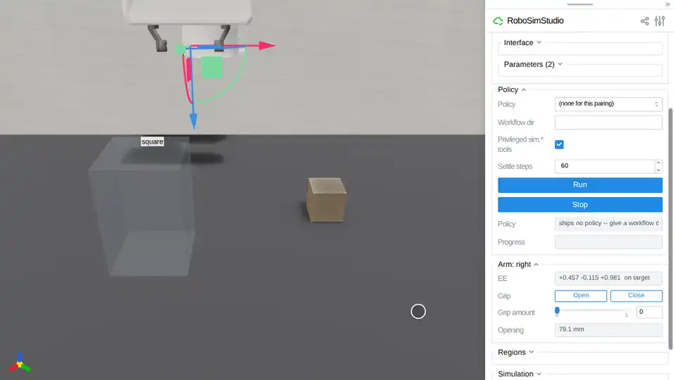

# Tasks

A task says what is on the bench and when an episode succeeds. This page also
covers how to run one.

<!-- examples:start: written by scripts/example_readmes.py from each script's docstring -->

## Your first task



A task is a short document: what is on the bench, and when it counts as done.

`bench.task` reads the document and `bench.Env` builds it, robot and all.
The studio opens with the goal beside the scene. Drag the cube into the square
and the goal turns true.

```bash
uv run examples/06_tasks/00_your_first_task.py
```

Source: [`00_your_first_task.py`](00_your_first_task.py)

## Goals and rewards


A goal is one clause built from measures; a reward says how close an episode came.

The cube must be in the square, still and clear of the hand for one second.
`once` latches success the first time that holds, and `(fraction)` pays one
share per clause that holds now. `env.step` returns both for one second, then
the studio shows each clause as you drag.

```bash
uv run examples/06_tasks/01_goals_and_rewards.py
```

Source: [`01_goals_and_rewards.py`](01_goals_and_rewards.py)

## Episodes and samplers


A task has numbered episodes, and a sampler decides how each one starts.

`register_sampler` names a function a document can cite. It returns where the
cube starts in episode *k*, drawn from a generator seeded for that episode, so
`env.reset(k)` builds the same start every time.

```bash
uv run examples/06_tasks/02_episodes.py
```

Source: [`02_episodes.py`](02_episodes.py)

<!-- examples:end -->

## The document

An `Env` is a `Sim`, so `rss.view` and anything else that takes a `Sim` takes it.

| Section | What it says |
| --- | --- |
| `:objects` | What moves: `name - type`, where a type is a registered asset |
| `:fixtures` | What is welded in place, in the same form |
| `:regions` | Boxes `(x0 y0 x1 y1)` in a `:target`'s frame, or on the bench top when none is named; `:z-range` for height |
| `:staging` | The cell, the robot, the physics bundle, cameras, episodes, `:max-steps` |
| `:init` | What must hold at the start, checked once the scene settles |
| `:goal` | One clause: when the episode succeeds |
| `:reward` | `(fraction)` (the default) or `(progress MEASURE (:gate g))` |
| `:observe` | Measures recorded every step that score nothing |
| `:artifacts` | `(:graph LABEL "DIR")`: the graphs that solve it, a folder under the task's home |

## Goals

Comparisons put a measure on the left and a number on the right:
`(>= (containment cube square) 1.0)`.

| Kind | Words |
| --- | --- |
| Logic | `and`, `or`, `not`, `worst-of` |
| Time | `once` (latch the first success), `hold-for SECONDS`, `after`, `peak`, `integral` |
| Measures | `containment`, `speed`, `height`, `on`, `contact-force`, `hands-clear`, `gripped`, `alignment`, `tcp-distance` |

`once` latches success; the reward keeps changing after it. `(fraction)` pays
one share per clause that holds now.

## Objects and physics

A document names an object type: `Body.from_spec` makes one from any rigid or
slab constructor, and `register_asset` registers it. Physics is a named bundle,
never raw numbers:

| Bundle | For |
| --- | --- |
| `mujoco_500hz@v1` | Picking things up: the arm and every free body in one MuJoCo island, 50 Hz over 500 Hz |
| `rigid_mujoco@v1` | Pushing things: free bodies on VBD beside a MuJoCo arm, which pushes but cannot pinch |
| `cloth_vbd@v1` | A sheet beside an arm |

`bench.register_arrangement` registers your own bundle; `bench.register_camera_rig`
registers cameras for `(:cameras NAME)`.

## Running many episodes

`bench.rollout` scores one episode. A `JobSpec` runs many and writes one results
row per episode (see [Policies](../07_policies/README.md#many-worlds)). From a
shell, a task root holds one folder per suite, each with `.task` files and a
`records.py` that registers their types and samplers. `--task-root` adds a root:

```bash
uv run --extra gap scripts/bench_run.py --task-root my_tasks --task push/cube \
    --solve graph --graph pick --episodes 0:16 --num-worlds 16
```

The benchmark's own task suites are not in this release yet.

**See also:**

- [Policies](../07_policies/README.md) for the graphs that solve a task
- [Studio](../05_studio/README.md) for the page an `Env` opens on
