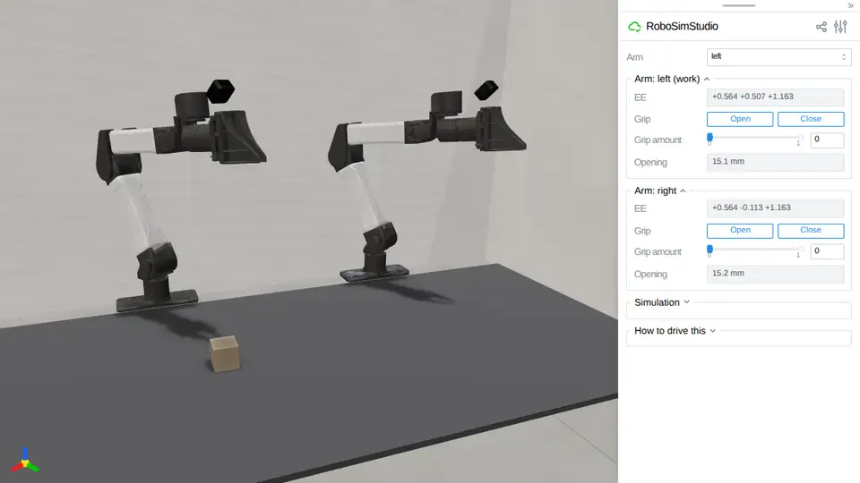
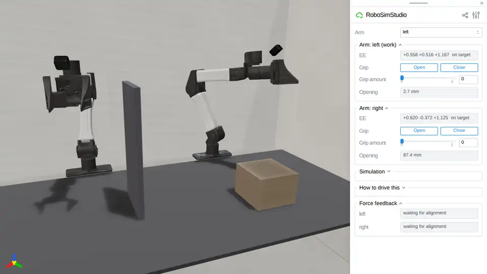

# Teleoperation

Driving a simulated YAM from a real leader arm, and feeling
what the simulated arm runs into on the leader's own servos.

<!-- examples:start: written by scripts/example_readmes.py from each script's docstring -->

## Leader arm



Drive the simulated YAM from a real leader arm, read only.

Each control step reads every connected leader, converts servo ticks to joint
angles through a calibration file, and applies them as one `joint_position`
action. Nothing is written to a servo. The cube is on the arm's own engine,
`rss.MUJOCO_500HZ`, so closed jaws hold it by friction. `--simulate` runs a
scripted hand that sweeps both arms and works the jaws, with no hardware. Needs
the `[lerobot-feetech]` extra and a calibrated leader arm.

```bash
uv run --extra lerobot-feetech examples/09_teleop/00_leader_arm.py
```

Source: [`00_leader_arm.py`](00_leader_arm.py)

## Force feedback



Feel what the simulated arm runs into, on the leader arm's own servos.

Where the simulated arm cannot reach your hand -- its side against the welded
panel, its hand pressed on the crate -- the gap is rendered as torque on the
leader. In free space no motor is energized. Run `--no-feedback` first: it
drives the simulation and never energizes a motor. `--simulate` runs a
scripted hand, with no hardware, whose sweep meets the panel; there is nothing
to feel. Needs the `[lerobot-feetech]` extra and a calibrated leader arm.
With feedback on, the leader's servos are powered: keep clear of the arm and
keep its power switch in reach.

```bash
uv run --extra lerobot-feetech examples/09_teleop/01_force_feedback.py
```

Source: [`01_force_feedback.py`](01_force_feedback.py)

<!-- examples:end -->

## What you need

| Item | What |
| --- | --- |
| Leader arm | A YAM leader on Feetech STS3215 bus servos: six joints and a trigger per arm. A bimanual leader is two arms on two buses. |
| Adapter | One USB-serial adapter per arm (WCH CH340/CH341, USB id `1a86:55d3`). |
| Extra | `lerobot-feetech`: `uv sync --extra lerobot-feetech` in a checkout, or `pip install "robosimstudio[lerobot-feetech] @ git+https://github.com/robosimstudio/robosimstudio"`. Every hardware command below runs with `uv run --extra lerobot-feetech`. The Feetech bus driver comes from `lerobot`. |
| udev rule | `scripts/udev/99-ch340-serial.rules`, so each adapter has a fixed device path. |
| Calibration | A JSON file keyed by adapter serial, written by `scripts/calibrate_leader_arms.py` to `scripts/calibration/local/yam_leader.json` (git-ignored), which is where the scripts here read it by default. `scripts/calibration/yam_leader.json` is a sample for two arms that are not yours. |
| Browser | Reaches the machine's ports 8080 (the scene) and 8081 (calibration), directly or through an SSH tunnel. |

The simulated arm is the shipped `yam_bimanual` with the teleoperation gains
`YAM_TELEOP_ARM` and `YAM_TELEOP_GRIP` from `robosimstudio.robots.teleop.follower`,
applied by the scene as an override. No task is needed: each script builds a
bare `rss.Scene(cell="bench_075")`.

Before you start, power the leader arm, keep its power switch within reach and
clear its sweep. Replace `<serial>` below with the serial on the adapter's label.
One arm is enough; a second arm is a second `<arm>:<port>` pair in `--leader`.

The **Pass:** lines in each section below are the rig checklist: run the
sections in order on a real leader arm. A failure points at
[Troubleshooting](#troubleshooting).

## The udev rule

`/dev/ttyACM0` is whichever adapter enumerated first and can swap across a
reboot or a re-plug. Address each adapter by its serial number instead:

```bash
sudo cp scripts/udev/99-ch340-serial.rules /etc/udev/rules.d/
sudo udevadm control --reload-rules && sudo udevadm trigger
ls -l /dev/ch340-*
```

Each adapter now appears as `/dev/ch340-<serial>`. The calibration file is keyed
by that serial, so arms that swap places keep their calibration. Label each
arm's controller with its serial.

**Pass:** `ls -l /dev/ch340-*` lists one symlink per connected arm, and each
serial matches its label.

## Calibrate

```bash
uv run --extra lerobot-feetech python scripts/calibrate_leader_arms.py \
    --leader left:/dev/ch340-<left-serial>,right:/dev/ch340-<right-serial> \
    --out scripts/calibration/local/yam_leader.json
```

The tool opens a page on port 8081 (`http://localhost:8081`) where the whole
workflow runs: a ghost stands at each target pose and the arm mesh follows the
leader.

| Step | In the page |
| --- | --- |
| **Start** | Opens the first arm's bus, torque off. |
| Each joint, five poses | Move that one leader joint into the ghost and press **Capture**. **Invert direction** flips the preview if it moves the wrong way. |
| Gripper | Open fully, **Capture**; close fully, **Capture**. |
| Next arm | Automatic. The file is written after every capture, so an interrupted run resumes where it stopped. |

The five poses fit `ticks = slope * radians + intercept` per joint, which gives
`ticks_per_radian`, `sign` and `offset_ticks` together. A residual over 40 ticks
is flagged in the results list; **Redo last joint** sweeps it again.

| Flag | Does |
| --- | --- |
| `--leader` | `<arm>:<port>` pairs. The arm names are the robot's own, `left` and `right`. |
| `--out` | The file to write, and to resume from. |
| `--embodiment`, `--cell` | Another registered robot or cell. The defaults are `yam_bimanual` and `bench_075`. |
| `--zero-only` | One capture per arm at the home pose. Rewrites every `offset_ticks` and keeps scale and sign: for a slipped horn. |
| `--gripper-only` | The two gripper captures alone. |

The file holds one entry per serial, `label` being for the person reading it:

```json
{"<serial>": {"label": "right",
  "joints": [{"name": "right_j0", "ticks_per_radian": 651.9, "sign": -1.0,
              "offset_ticks": 2002.0, "scale_source": "fitted"}, "..."],
  "gripper": {"name": "right_grip", "open_ticks": 2128.0, "closed_ticks": 2765.0}}}
```

`radians = sign * (ticks - offset_ticks) / ticks_per_radian`, with the
difference taken the short way round the encoder's 4096-count turn. Joints are in
servo-id order; ids `1..N` are assigned in that order when a bus opens.

**Pass:** after **Start** the status says the arm is connected with torque off
and the arm hangs loose; every joint fits under 40 ticks; the gripper's two
captures differ by several hundred ticks; the file holds an entry under your
serial with six joints and a gripper.

## Check the signs

```bash
uv run --extra lerobot-feetech python scripts/check_leader_signs.py --leader right:/dev/ch340-<serial>
```

Read-only. It prints one line per motor with `raw`, `angle` and a signed
`delta`; `<-- moving` marks the joint you are moving. Move one joint at a time.
A joint whose number climbs while the simulated arm moves the other way has the
wrong `sign`; flip that one entry in the file.

**Pass:** each joint's `delta` changes only when that joint moves, and the
gripper's `cmd` runs 0 at open to 1 at closed.

## Drive the simulation from the leader

```bash
uv run --extra lerobot-feetech examples/09_teleop/00_leader_arm.py --leader right:/dev/ch340-<serial>
```

Name one `--leader` pair per arm you have; an arm without one keeps its gizmo.

The studio offers the same thing as a panel. Open a bare scene with
`panels="all"` and the ports in the config, then in the **Leader arm** folder
press **Connect** and tick **Drive from leader arm**. Untick it and the arm
stays where the leader left it, for the gizmo to pick up.

```python
from robosimstudio_studio import StudioConfig

rss.view(sim, panels="all", config=StudioConfig(
    leader_arm_ports=(("right", "/dev/ch340-<serial>"),),
    leader_arm_calibration="scripts/calibration/local/yam_leader.json"))
```

**Pass:** the simulated right arm snaps to the leader's pose on the first step,
its gizmo hidden, and then follows: each of the six joints moves the same way as
the leader's with no visible lag at a normal hand speed, the jaw closes when you
squeeze the trigger and opens when you release it, and the leader stays loose in
your hand.

## Force feedback

> **Note.** Force feedback is experimental. The version in this release has been
> checked against a simulated servo bus and has not yet been run on a leader
> arm. Pass each step below before you rely on it.

```bash
uv run --extra lerobot-feetech examples/09_teleop/01_force_feedback.py --leader right:/dev/ch340-<serial> --no-feedback
uv run --extra lerobot-feetech examples/09_teleop/01_force_feedback.py --leader right:/dev/ch340-<serial>
```

Run `--no-feedback` first to check the calibration with no motor energized. The
scene has a panel welded beside the right hand and a 20 kg crate under the left.

**What you feel.** Where the simulated arm is blocked (its side on the panel,
its hand on the crate, its jaw on something solid), each blocked servo gets a
goal that leads your hand back toward the arm, under a torque limit. The further
behind the arm is, the harder the pull, up to `max_error`.

**Two clocks.** Each leader arm runs on a thread of its own at 100 Hz, reading
the bus and writing servo registers. The page steps the scene at its control
rate, 60 Hz by default, applies the leader pose and reads the arm back. Contact
is rendered at a steady rate whatever the scene costs to step.

**Deadband.** A motor is energized only when its joint's mismatch leaves a
deadband of 0.04 rad + 0.045 s × joint speed, capped at 0.16 rad, about the
follower's tracking lag, so a moving hand's lag is not felt as contact. The grip
uses 0.02 s and a cap of 0.08 of its stroke. Each follower sample is compared
with the target it was chasing when measured, so a late page step is not felt
either. An energized motor lets go at three quarters of the deadband, so a joint
on the threshold does not chatter; in between, the goal is your hand's own
position.

**Staleness.** If no simulation state arrives for 0.25 s (or three page steps,
if that is longer), for example because the page is paused, rebuilding or
closed, every motor is disarmed. A joint re-arms only after leader and follower
have agreed for 0.5 s, and then only on a later sample that leaves the deadband.

The page shows one status line per arm: `free`, `pushing back: right_j0 -0.21`,
`waiting for alignment`, `suspended`. `--trace PATH` writes per-tick timing on
the way out; `scripts/analyze_leader_trace.py PATH` reads it.

| Knob (`ComplianceConfig`) | Default | Meaning |
| --- | --- | --- |
| `deadband` | 0.04 | Mismatch below which nothing is rendered, in rad or stroke fraction. |
| `velocity_deadband`, `max_deadband` | 0.045 s, 0.16 | How the deadband rises with speed, and its ceiling. |
| `release_hysteresis` | 0.01 | How far back inside the deadband the mismatch must fall before an energized joint lets go. Kept in proportion as the deadband rises: a quarter of it at these defaults. |
| `ramp_gain` | 5.0 | How steeply the correction grows past the deadband. |
| `max_error` | 0.2 | Cap on how far the goal leads the hand. |
| `p_coefficient`, `d_coefficient` | 30, 5 | Feetech position-loop gains while a joint is energized. |
| `torque_limit` | 300 | Feetech torque duty cap, 0-1000: how hard the arm can push. |

Pass a `ComplianceConfig` (from `robosimstudio.robots.teleop.force_feedback`) to
`Teleoperation` to change them; the example uses the defaults.

### Rig checklist

1. **Feedback off** (`--no-feedback`). The console prints
   `Driving right without feedback: no motor will be energized.` and the
   **Force feedback** folder shows `reading only (no motor is energized)`.
   **Pass:** the arm drives the simulation as above, stays loose, and no servo
   warms or hums; swing the right hand into the panel and the simulated arm
   stops at it while your hand feels nothing.
2. **Feedback on, free space.** The console prints
   `Force feedback armed on right at 100 Hz. ...`; the status goes
   `waiting for alignment`, then, after half a second held still,
   `[right] alignment held; contact feedback is live again.` and `free`.
   **Pass:** moving slowly, then briskly, and working the trigger on air, the
   status stays `free`, no servo energizes, and the arm feels as loose as in
   step 1.
3. **Feedback on, contact** (same session). Swing the right hand sideways into
   the panel, press the left hand down on the crate (a second `--leader` pair),
   close the jaw on the panel's edge. **Pass:** the status names `right_j0`,
   the left shoulder pitch joint and `right_grip` in turn; the loaded joint
   pushes back toward where the simulated arm stopped, harder the further you
   push, and lets go to `free` as soon as you back away; the trigger pushes back
   on the panel's edge and not on air; unloaded joints stay loose.
4. **Staleness** (same session). Press **Pause** on the page while in contact.
   **Pass:** within about 0.3 s the console prints
   `[right] no simulation state for over 0.25 s; feedback suspended.`, the
   status says `suspended` and the arm goes slack; after **Pause** again, holding
   the leader still where the simulated arm is for half a second prints
   `alignment held; contact feedback is live again.`, and a joint still in
   contact stays off until you have let go and re-aligned.
5. **Shutdown.** Ctrl-C once in contact and once in free space; in a third run,
   close the browser tab. **Pass:** each prints `Stopped; leader torque is off.`,
   exits with code 0 and leaves the arm slack at once, and the next start does
   not say `refusing to arm against nonzero torque limits`.
6. **Trace.** Add `--trace outputs/ff.json`, repeat steps 2 and 3, exit, then run
   `uv run python scripts/analyze_leader_trace.py outputs/ff.json`. It reports,
   per arm, the loop period percentiles against the 10 ms target, where an
   armed tick's time went, the torque transitions per second and the slot with
   the worst mismatch, then the page's publish gap. **Pass:** few ticks over
   1.5 times the target period, transitions `calm` outside contact,
   `follower sample age` p95 within a few page steps, and no `glitch` in
   `events`.

### Open questions

- The `ComplianceConfig` defaults come from a reference rig on the same servos;
  they have not been tuned on this scene.
- By default each follower sample is compared with the leader pose the arm was
  chasing when it was measured. The other form, the hand's pose at the instant
  the leader thread looks, is the only one that has been felt on hardware;
  `Teleoperation(..., compare="live")` selects it. If step 2 fails and step 6
  shows no timing fault, try the other form and report which one felt right.

## Safety

- Torque is off at rest, off while the page is stale, and off on the way out.
  The page closing, Ctrl-C, SIGTERM and a fault take the same path, which also
  puts the servos' own gains back.
- With feedback on, the servos are powered and the arm can move by itself. Keep
  clear of it and keep its power switch in reach.
- A process killed outright (`kill -9`, a power cut to the computer) cannot run
  that path. The servos keep their last goal and torque limit until their own
  power is cut.
- Startup refuses to arm against a servo that comes up with a nonzero torque
  limit. Power-cycle the arm.
- Match poses before you connect. The leader's angles become the targets on the
  first step; a leader far from the simulated arm's pose makes it jump.

## Troubleshooting

| Symptom | Cause | Fix |
| --- | --- | --- |
| Nothing under `/dev/ch340-*` | The udev rule is not installed, or the adapter is not a CH340 | Install [the rule](#the-udev-rule). `lsusb` should show `1a86:55d3`. |
| Calibration exits with a bus error | A servo does not answer | Check the daisy chain and power. |
| A simulated joint moves the opposite way | The wrong `sign` for that joint | Flip that entry in the file. `check_leader_signs.py` shows which. |
| The gripper's `cmd` runs 1 to 0 | `open_ticks` and `closed_ticks` are swapped | Swap them in the file. |
| Two lines move in `check_leader_signs.py` for one joint | The servo ids do not match the joint order | Check the order on the daisy chain: ids `1..N` are assigned in joint order when a bus opens. |
| Every joint reads a constant angle off | A slipped horn or a re-seated servo moved the zero | `calibrate_leader_arms.py --zero-only`. |
| One joint jumps a whole turn at one point of its travel | Its `offset_ticks` is a turn out | Re-zero that arm. |
| Free motion pushes back, or a joint stiffens briefly | Lag read as contact. The deadband absorbs about 45 ms of it, which is what a recorded session measured | Use `YAM_TELEOP_ARM` (18 ms lag vs 92 ms at the asset's gains), keep the scene light with `render_every=1`, and check the loop period and the page gap with `--trace`. Note the joint and the speed. |
| A joint pushes back while still, touching nothing | The model's joint range clamps a target the leader's travel puts outside it | `YAM_TELEOP_ARM` removes the arm joints' limits. |
| A push on the panel is felt on a wrist joint, or not at all | The base joint's `sign` or `offset_ticks` is wrong | [Check the signs](#check-the-signs), then re-zero. |
| `no simulation state for over 0.25 s; feedback suspended` | The page paused, or steps slower than the stale limit | Resume. Hold still for 0.5 s and the arm re-arms. |
| `refusing to arm against nonzero torque limits` | A previous run did not reach its torque-off | Power-cycle the leader. |
| The pull points away from the simulated arm, the arm stays stiff after `feedback suspended`, or a traceback replaces a one-sentence error | A bug | Stop with Ctrl-C (cut the arm's power if it stays stiff) and report it. |
| `SHUTDOWN ERROR: ...` | A servo did not acknowledge its torque-off | Power-cycle the arm and report the lines. |
| `could not open the leader on /dev/...` | Nothing on the port, or another process holds it | Check power and cable. Close the studio's **Leader arm** panel or the other script; one bus has one reader. |
| Trace: `CHATTER` | A mismatch sitting at the deadband | Note the joint and report the trace. |
| Trace: `suspend` events with the page open | The scene steps too slowly for the stale limit | Lighten the scene. |
| Trace: loop period p99 many times the 10 ms target | The leader thread is starved | Close other work on the machine. |

## See also

- `robosimstudio.robots.teleop.lerobot_controller`: calibration, tick conversion and the read-only controller.
- `robosimstudio.robots.teleop.force_feedback`: the algorithm, the gates and the servo writes.
- `robosimstudio.robots.teleop.follower`: the follower's gains, and the measurements behind them.
- `robosimstudio.robots.teleop.simulated`: what `--simulate` is and is not.
- `scripts/analyze_leader_trace.py --help`: what each line of the trace report means.
